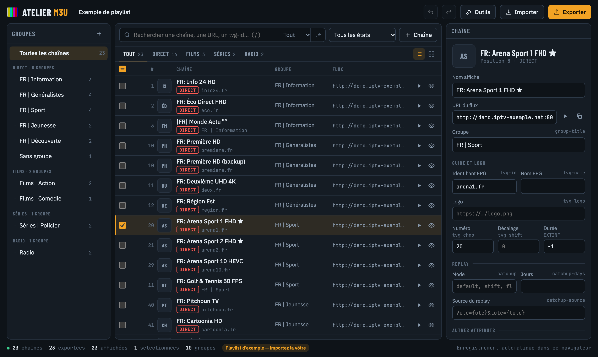
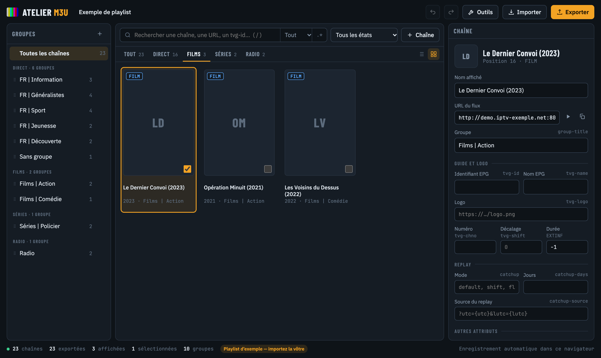
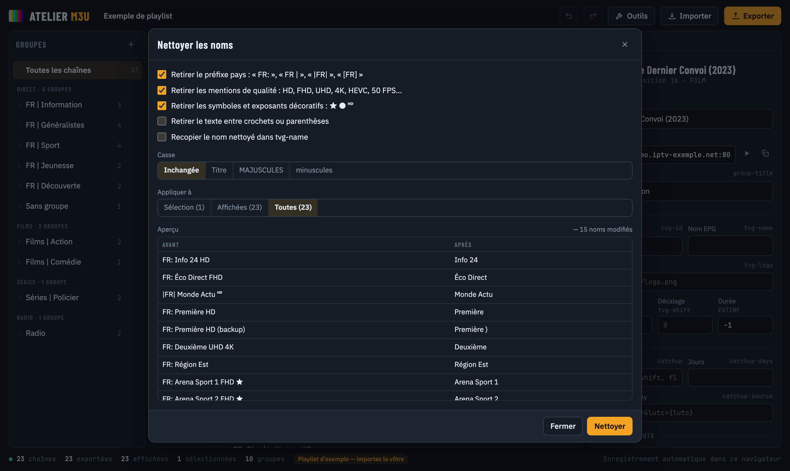
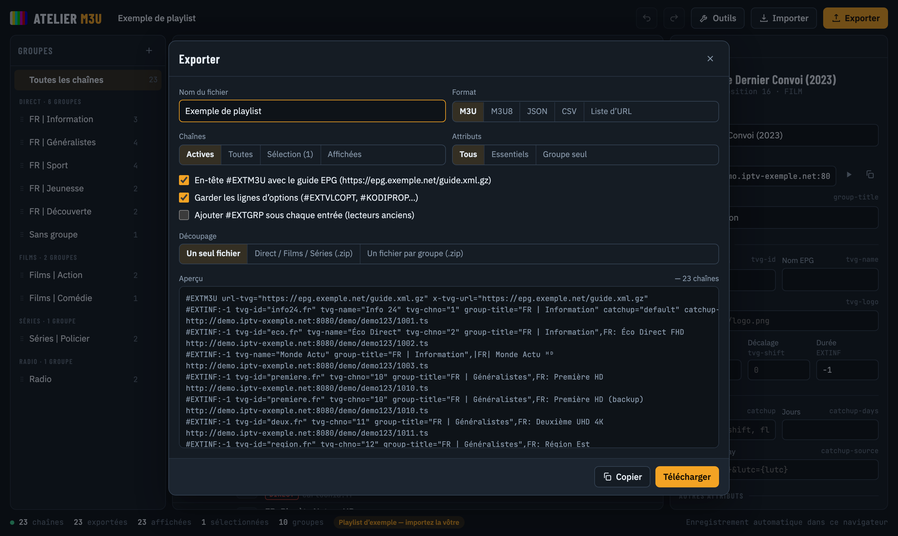
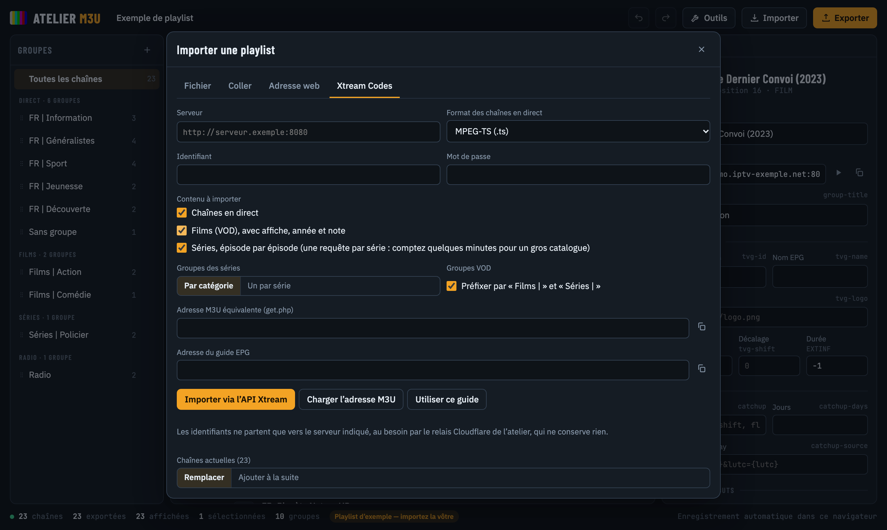
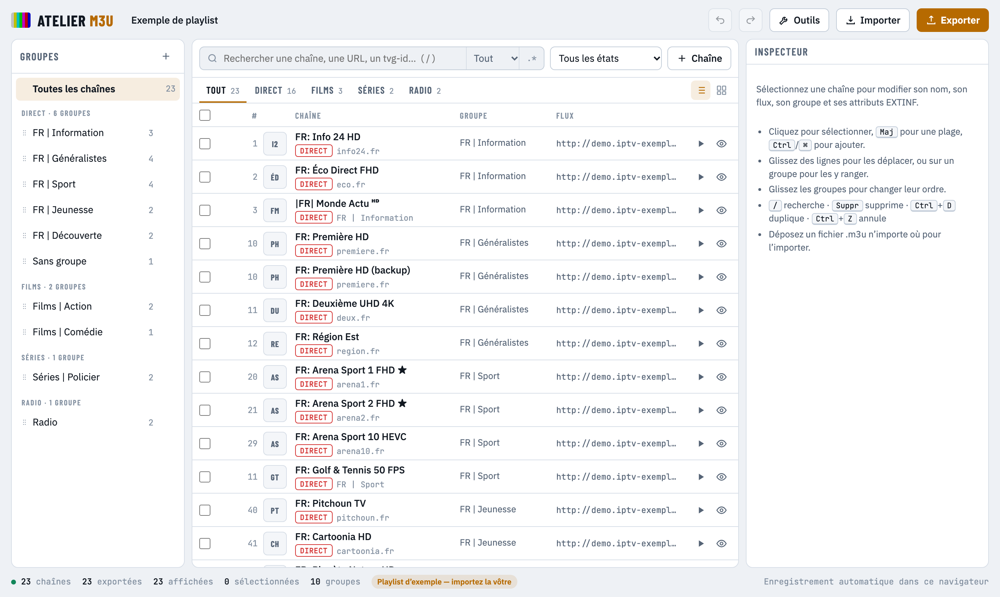
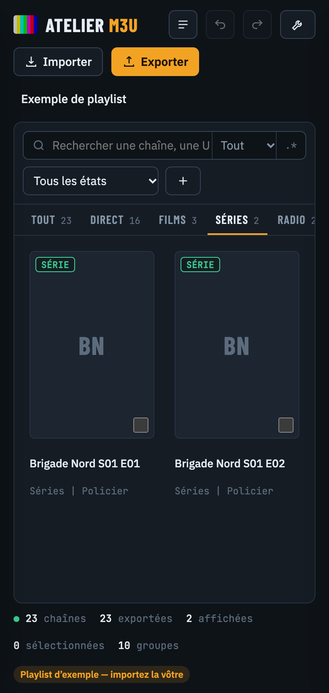

# Atelier M3U

Éditeur de playlists IPTV en ligne : chaînes en direct, films et séries. On importe une playlist M3U ou un compte Xtream Codes, on la range, on la nettoie, puis on l’exporte pour TiviMate, VLC, Kodi ou IPTV Smarters.

**En ligne : https://atelier-m3u.pages.dev**



## Sommaire

- [Fonctions](#fonctions)
- [Utilisation](#utilisation)
- [Raccourcis clavier](#raccourcis-clavier)
- [Confidentialité et données](#confidentialité-et-données)
- [Limites connues](#limites-connues)
- [Développement](#développement)
- [Déploiement](#déploiement)
- [Documentation technique](#documentation-technique)

## Fonctions

### Import

| Source | Détail |
|---|---|
| Fichier | `.m3u`, `.m3u8`, `.txt`, `.json` (export de l’atelier), compressés en `.gz` ou non. Plusieurs fichiers à la fois, par bouton ou glisser-déposer n’importe où sur la page. |
| Texte collé | Onglet « Coller », ou collage direct (Ctrl+V) d’un texte qui commence par `#EXTM3U`. |
| Adresse web | Lecture directe, puis par le [relais](docs/relais.md) si le serveur bloque le navigateur. |
| Xtream Codes | API `player_api.php` : direct, films avec affiche, année et note, séries épisode par épisode. Ou adresse `get.php` équivalente. |

Chaque import peut **remplacer** la playlist ou **s’ajouter à la suite**.

### Édition

- **Onglets Direct / Films / Séries / Radio**, avec leurs effectifs. Le type est déduit de l’URL (`/movie/`, `/series/`, extension) et du nom (`S01E02`).
- **Vue liste** virtualisée, fluide avec des dizaines de milliers d’entrées, et **vue en affiches** pour la VOD.
- **Groupes** classés par type : renommer (double-clic), réordonner par glisser, fusionner, exclure de l’export, exporter un seul groupe, supprimer.
- **Inspecteur** : nom, URL, groupe, `tvg-id`, `tvg-name`, `tvg-logo`, `tvg-chno`, `tvg-shift`, durée, replay (`catchup`, `catchup-days`, `catchup-source`), attributs libres, lignes `#EXTVLCOPT` / `#KODIPROP` / `#EXTHTTP`. L’entrée générée s’affiche en direct.
- **Sélection multiple** (Maj, Ctrl/⌘, tout sélectionner) avec actions groupées : ranger dans un groupe, appliquer un attribut, préfixe ou suffixe, activer ou désactiver, dupliquer, déplacer en haut ou en bas, supprimer.
- **Glisser-déposer** des lignes pour les réordonner, ou sur un groupe pour les y ranger.
- **Recherche** sur tous les champs ou un seul, en expression régulière si besoin, et **filtres d’état** : désactivées, sans logo, sans `tvg-id`, sans groupe, URL invalide, URL ou nom en double.
- **Annuler / rétablir** sur 80 étapes. **Enregistrement automatique** dans le navigateur.
- **Lecteur intégré** pour les flux HLS en https (hls.js).



### Outils

| Outil | Rôle |
|---|---|
| Rechercher et remplacer | Sur un champ ou un attribut, texte ou regex (`$1`…), avec aperçu avant / après. |
| Nettoyer les noms | Retire le préfixe pays (`FR:`, `\|FR\|`, `[FR]`), les mentions de qualité (HD, FHD, 4K, HEVC, 50 FPS…), les symboles (★ ᴴᴰ), le texte entre crochets ; change la casse ; recopie dans `tvg-name`. |
| Doublons | Par URL, nom normalisé, `tvg-id` ou nom + groupe : sélection ou suppression, la première entrée est gardée. |
| Trier | Tri naturel (« Sport 2 » avant « Sport 10 ») par nom, numéro, `tvg-id`, groupe ou type, dans chaque groupe ou globalement ; tri des groupes. |
| Numéroter | Écrit `tvg-chno` dans l’ordre de la playlist, avec pas, saut entre groupes ou départ à la centaine. |
| Regrouper | Par préfixe du nom, par type de flux, par série (`S01E02`, `1x02`), ou par règles `expression => groupe`. |
| Guide EPG | Adresse du guide dans l’en-tête, et association automatique des `tvg-id` et logos depuis un fichier XMLTV (`.xml`, `.xml.gz`) ou son adresse. |
| Xtream Codes | Changer de serveur, d’identifiant ou de mot de passe sur toutes les URL d’un compte, changer l’extension des flux en direct, générer les adresses `get.php` et `xmltv.php`. |
| Propriétés | Attributs de la ligne `#EXTM3U` (`url-tvg`, `x-tvg-url`, `tvg-shift`, `catchup`…). |
| Statistiques | Effectifs par type, groupes les plus fournis, serveurs, protocoles, entrées à corriger (avec filtre en un clic). |



### Export

- Formats : **M3U**, **M3U8**, **JSON** (réimportable), **CSV** (séparateur `;`, ouvrable dans Excel), **liste d’URL**.
- Contenu : chaînes actives, toutes, la sélection ou l’affichage en cours.
- Attributs : tous, essentiels seulement (`tvg-id`, `tvg-name`, `tvg-logo`, `tvg-chno`, `group-title`), ou groupe seul.
- Options : en-tête EPG, lignes d’options, `#EXTGRP` pour les lecteurs anciens.
- Découpage : un fichier, **Direct / Films / Séries** en `.zip`, ou un fichier par groupe en `.zip`.
- Copie dans le presse-papiers.



## Utilisation

1. Ouvrez https://atelier-m3u.pages.dev. Une playlist d’exemple est chargée tant que vous n’importez pas la vôtre.
2. **Importer** : déposez votre fichier, collez la playlist, ou ouvrez l’onglet **Xtream Codes** et renseignez serveur, identifiant et mot de passe.
3. Rangez et corrigez : onglets de type, groupes à gauche, inspecteur à droite, menu **Outils**.
4. **Exporter** : choisissez le format et téléchargez. Chargez le fichier dans votre lecteur.



L’interface suit le thème clair ou sombre du système et s’adapte au téléphone : les groupes et l’inspecteur s’ouvrent en panneaux.

| Thème clair | Mobile |
|---|---|
|  |  |

## Raccourcis clavier

| Touche | Action |
|---|---|
| `/` ou `Ctrl/⌘ F` | Rechercher |
| `↑` `↓` (`Maj` pour étendre) | Parcourir la liste |
| `Ctrl/⌘ A` | Tout sélectionner (dans l’affichage) |
| `Ctrl/⌘ D` | Dupliquer la sélection |
| `Suppr` | Supprimer la sélection |
| `Ctrl/⌘ Z` / `Ctrl/⌘ Maj Z` ou `Ctrl Y` | Annuler / rétablir |
| `Ctrl/⌘ H` | Rechercher et remplacer |
| `Ctrl/⌘ O` / `Ctrl/⌘ S` | Importer / exporter |
| `Échap` | Fermer la fenêtre ou le panneau |

## Confidentialité et données

- La playlist est stockée **uniquement dans le navigateur** (`localStorage`). Elle n’est ni envoyée ni conservée sur un serveur. Elle ne suit donc pas d’un appareil à l’autre : exportez-la pour la transférer.
- Les identifiants Xtream ne partent que vers le serveur IPTV indiqué. Quand ce serveur bloque la lecture directe, la requête passe par le relais de l’atelier sur Cloudflare, qui ne journalise ni ne garde rien (voir [docs/relais.md](docs/relais.md)).
- Les URL Xtream contiennent l’identifiant et le mot de passe en clair : un fichier exporté est à garder pour soi.

## Limites connues

- **Lecture des flux** : la plupart des serveurs Xtream diffusent en `http`, que le navigateur refuse de lire sur une page `https`. Les flux MPEG-TS et MKV ne sont pas lisibles par les navigateurs. Copiez l’URL dans VLC ou un lecteur IPTV. Le relais ne transmet volontairement aucun flux audio ou vidéo.
- **Séries Xtream** : une requête par série (6 en parallèle). Un catalogue de plusieurs milliers de séries prend plusieurs minutes ; l’import peut être arrêté.
- **Taille** : le relais limite chaque réponse à 100 Mo. Le stockage du navigateur est limité à quelques Mo selon le navigateur : au-delà, l’enregistrement automatique échoue sans bloquer l’édition. Exportez régulièrement les très grosses playlists.

## Développement

Pas de dépendance ni d’étape de compilation lourde : la page est un seul fichier HTML (CSS et JavaScript inclus).

```bash
npm run build      # src/app.html -> public/index.html
npm run dev        # serveur local avec le relais (wrangler pages dev public)
node tests/e2e.mjs [chemin/vers/playwright-core]   # test de bout en bout
```

Le test de bout en bout sert `public/` et simule un serveur Xtream, puis pilote Chrome sans fenêtre. Il couvre l’affichage, les onglets et la vue affiches, chaque outil, le nettoyage, l’annulation, l’inspecteur, l’import Xtream (direct, films, épisodes), l’export, le téléchargement et l’affichage mobile. Il demande Google Chrome et le paquet `playwright-core` (installé ou passé en argument).

Arborescence :

```
src/app.html            page complète (structure, styles, script)
scripts/build.mjs       assemble public/index.html (doctype, métadonnées, icône)
functions/api/fetch.js  relais Cloudflare Pages Function
public/_headers         en-têtes de sécurité
tests/e2e.mjs           test de bout en bout
docs/                   documentation technique et captures
```

## Déploiement

Cloudflare Pages, projet `atelier-m3u`, branche de production `main`.

- **Automatique** : chaque push sur `main` lance `.github/workflows/deploy.yml` (construction puis `wrangler pages deploy`). Le secret `CLOUDFLARE_API_TOKEN` du dépôt doit avoir le droit *Cloudflare Pages : Edit*.
- **Manuel** : `npm run deploy` (wrangler connecté au compte Cloudflare).

## Documentation technique

- [Architecture](docs/architecture.md) : modèle de données, rendu virtualisé, historique, enregistrement.
- [Format M3U et Xtream](docs/format-m3u.md) : syntaxe lue et écrite, attributs, correspondance avec l’API Xtream.
- [Relais](docs/relais.md) : rôle, protections, réponses d’erreur.
- [Journal des versions](CHANGELOG.md)
