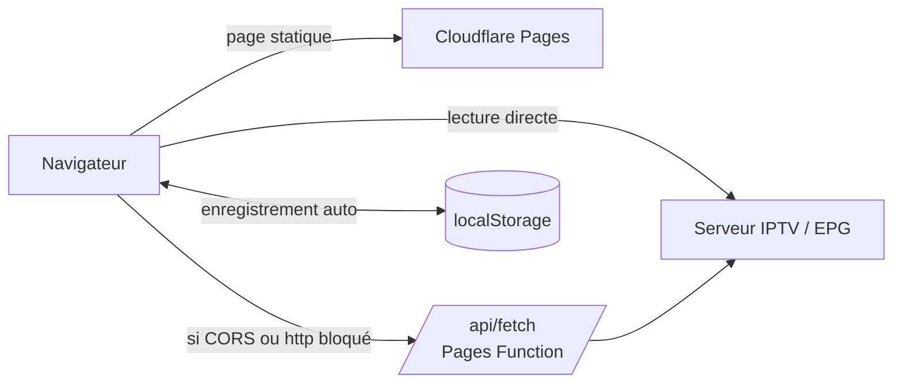

# Architecture

L’atelier est une page unique sans framework : `src/app.html` contient la structure, les styles et le script. `scripts/build.mjs` l’enveloppe d’un `<!doctype html>`, des métadonnées et de l’icône pour produire `public/index.html`, servi par Cloudflare Pages avec la fonction `functions/api/fetch.js`.



## Modèle de données

L’état tient dans un objet `S` :

| Champ | Contenu |
|---|---|
| `S.header` | Attributs de la ligne `#EXTM3U` (`url-tvg`, `x-tvg-url`…). |
| `S.chans` | Tableau ordonné des entrées. **L’ordre de ce tableau est l’ordre d’export.** |
| `S.order` | Ordre d’affichage des groupes. |
| `S.hidden` | Groupes exclus de l’export. |
| `S.keep` | Groupes créés à la main et encore vides (sinon un groupe sans entrée disparaît). |
| `S.sel`, `S.cur`, `S.anchor` | Sélection, entrée ouverte dans l’inspecteur, point de départ d’une sélection Maj+clic. |
| `S.f` | Filtres : groupe, recherche, regex, champ, type, état. |
| `S.view` | Entrées visibles après filtrage, recalculées par `computeView()`. |

Une entrée :

```js
{
  id: 42,                       // identifiant interne, stable pendant la session
  name: "FR: Info 24 HD",       // titre après la virgule de #EXTINF
  url: "http://…/1001.ts",
  dur: "-1",                    // durée #EXTINF, gardée telle quelle
  attrs: { "tvg-id": "…", "group-title": "…" },   // attributs, dans l’ordre lu
  extra: ["#EXTVLCOPT:http-user-agent=…"],         // lignes d’options, réécrites telles quelles
  off: false,                   // désactivée (exclue de l’export)
  meta: { kind: "serie", show: "…", season: 1, episode: 2, year: "2023", rating: "7.4" }
}
```

`meta` n’existe que pour les entrées importées par l’API Xtream. Il sert à l’affichage (affiches, saison, note) et **n’est jamais écrit dans le M3U**.

Le groupe d’une entrée est son attribut `group-title` (fonctions `grp()` / `setGrp()`). Le type (`ctype()`) n’est pas stocké : il est déduit à chaque calcul de l’URL et du nom, si bien qu’une modification de l’URL change le type sans autre action.

## Cycle d’une modification

Toute modification passe par `mutate(fn, message)` :

1. `pushUndo()` sérialise l’état (`snap()`) sur la pile d’annulation (80 étapes, 60 Mo au plus) et vide la pile de rétablissement.
2. `fn()` modifie `S`.
3. `refresh()` resynchronise les groupes (`syncGroups()`), recalcule l’affichage (`computeView()`), redessine groupes, liste, inspecteur et barre d’état, puis programme l’enregistrement.

La saisie dans l’inspecteur est un cas à part : la première frappe d’une session d’édition crée le point d’annulation, puis `softRefresh()` (temporisé) met à jour la liste sans redessiner l’inspecteur, pour ne pas perdre le curseur.

## Rendu virtualisé

Seules les lignes visibles, plus une marge, existent dans le DOM.

- **Liste** : lignes de 48 px. Un conteneur `#spc` prend la hauteur totale ; `#rows` est décalé par `transform` au premier rang affiché.
- **Affiches** : le nombre de colonnes et la hauteur de rang sont calculés d’après la largeur (`GEO`), puis le même principe s’applique par rang.

Les logos qui échouent sont retenus dans `badLogo` pour ne pas être redemandés à chaque défilement ; l’initiale de la chaîne reste affichée.

## Enregistrement

`autosave()` écrit l’état dans `localStorage` (clé `atelier-m3u:v1`) 700 ms après la dernière modification. Une erreur de quota est ignorée : l’édition continue, seul l’enregistrement automatique manque. Au démarrage, `boot()` restaure cet état, sinon charge la playlist d’exemple (signalée dans la barre d’état).

La préférence de vue (liste ou affiches) est gardée sous `atelier-m3u:v1:vm`.

## Fichiers générés

- **ZIP** : `makeZip()` écrit une archive sans compression (CRC32, noms en UTF-8), utilisée pour les exports découpés.
- **Téléchargement** : lien `blob:` hors de Claude. Dans un Artifact claude.ai, la page passe par la capacité `downloads`, et les `.m3u` sont livrés dans un `.zip` (ce type de fichier n’y est pas accepté).

## Réseau

`getText(url)` tente d’abord une lecture directe ; en cas d’échec (CORS, contenu mixte http, réseau), elle repasse par `/api/fetch?url=…` avec l’en-tête `x-atelier: 1`. `decodeBody()` décompresse le gzip d’après sa signature (`1f 8b`), ce qui couvre les guides `.xml.gz`, puis décode selon le jeu de caractères annoncé.
